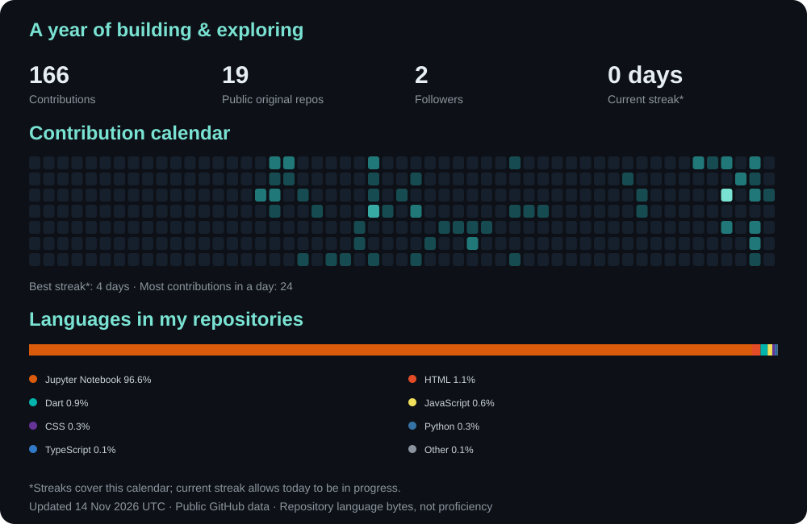

  

<h1 align="center">Hi, I'm Chaitra ✨</h1>
<h3 align="center">Computer Science · Applied Maths</h3>

I like turning ideas into code—and learning something new along the way.

  
  

  
  
  

## About me

I am a **3rd year CSE student (Applied Mathematics)**.

- 🗣️ Exploring **NLP, multilingual text, speech, and information retrieval**.
- 🧠 Building projects with **machine learning, deep learning, and browser-based inference**.
- ⚛️ Connecting mathematical ideas with practical software, from quantum error correction to learner analytics.
- 🌊 Creating web experiences that make complex ideas easier to explore.
- 🌱 Open to **internships, research opportunities, and project collaborations**.

## Tech stack & skills

<h3 align="center">Programming languages</h3>

  
  
  
  
  
  
  
  
  

<h3 align="center">AI & machine learning</h3>

  
  
  
  
  
  

NLP · LLMs · Generative AI · Deep learning · Prompt engineering · RAG · BiLSTM / sequence models · Speech recognition

<h3 align="center">Web & app development</h3>

  
  
  
  
  
  
  

Responsive design · REST APIs · Browser ML inference · Web Workers · Web Audio API · WebAssembly · PDF.js

<h3 align="center">Cloud, deployment & AI services</h3>

  
  
  
  
  
  
  
  

<h3 align="center">Core CS & developer tools</h3>

  
  
  
  

Data structures & algorithms · DBMS · Operating systems

<h3 align="center">Design & creative tools</h3>

  
  
  
  

UI design · AI video generation

## Featured projects

<b>🗣️ HUPP-LID — language identification for code-mixed text</b>

> Token-level, transliteration-aware language identification for Hindi, Urdu, Punjabi, and Pashto.

**Stack:** Python, PyTorch, NLP, MuRIL, XLM-R  
**Focus:** Identifying the language of individual words across mixed languages and scripts, with explicit treatment of Hindi/Urdu ambiguity.  
**Research:** Comparing dictionary and character n-gram baselines with neural and multilingual transformer models.

<b>⚛️ Quantum Error Correction ML Decoder</b>

> An interactive lab for exploring quantum error correction.

**Stack:** Python, PyTorch, BiLSTM, JavaScript  
**Features:** Trained decoders for 3-, 5-, and 7-qubit repetition codes; interactive error injection and parity checks.  
**Focus:** Making decoder behavior and performance easier to inspect.

[View project →](https://github.com/LakshmiChaitra/quantum-error-correction) · [Try the lab ↗](https://lakshmichaitra.github.io/quantum-error-correction/)

<b>🧭 PersonaLearn</b>

> Learner analytics with interactive machine-learning predictions.

**Stack:** Python, XGBoost, K-Means, JavaScript  
**Features:** Risk prediction, three learner activity clusters, cohort analytics, and rule-based study plans using historical OULAD data.  
**Focus:** Turning learner data into understandable insights with browser-based inference.

[View project →](https://github.com/LakshmiChaitra/persona-learn) · [Explore dashboard ↗](https://lakshmichaitra.github.io/persona-learn/)

<b>🎧 Seamless Minds</b>

> On-device transcription and English speech translation.

**Stack:** JavaScript, Whisper, WebAssembly, HTML/CSS  
**Features:** Audio transcription, English speech translation, timed SRT subtitles, and transcript comparison.

[View project →](https://github.com/LakshmiChaitra/transcription-) · [Try it ↗](https://lakshmichaitra.github.io/transcription-/)

<b>📚 DoChat</b>

> A document workspace with source citations.

**Stack:** JavaScript, PDF.js, BM25, IndexedDB  
**Features:** PDF and text search, relevant source excerpts, clickable citations, and saved conversations. The Python RAG API is retained as a separate backend prototype.

[View project →](https://github.com/LakshmiChaitra/dochat) · [Open workspace ↗](https://lakshmichaitra.github.io/dochat/)

<b>🏰 Midnight Castle</b>

> A four-realm 3D browser adventure.

**Stack:** JavaScript, Three.js, HTML/CSS  
**Features:** Connected realms, interactive spaces, locally saved letters, and a guided tour.

[View project →](https://github.com/LakshmiChaitra/midnight-castle) · [Enter the castle ↗](https://lakshmichaitra.github.io/midnight-castle/)

## GitHub activity

  

Refreshed daily from GitHub public activity. Language usage reflects repository code, not skill proficiency.

## Connect

  <a href="https://www.linkedin.com/in/chaitra-p-717157442">LinkedIn</a> ·
  <a href="https://lakshmichaitra.github.io/">Portfolio</a> ·
  <a href="mailto:chaitracollege@gmail.com">Email</a>

<b>Open to:</b> Internships · Research · Collaborations

<i>Powered by “wait, what if…” ✦</i>

